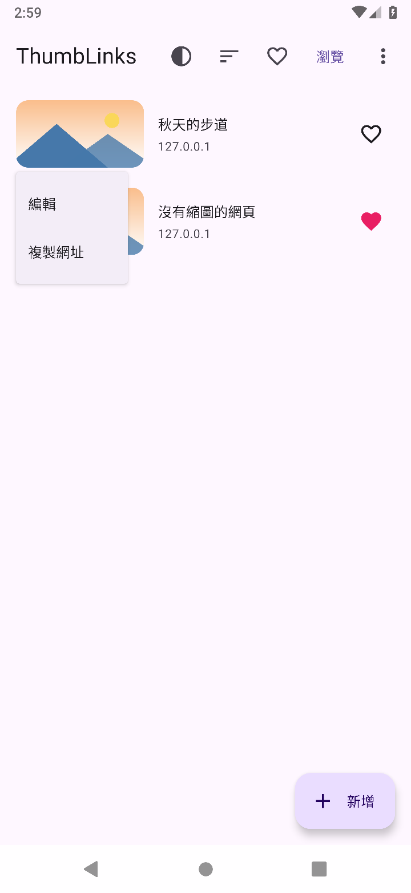
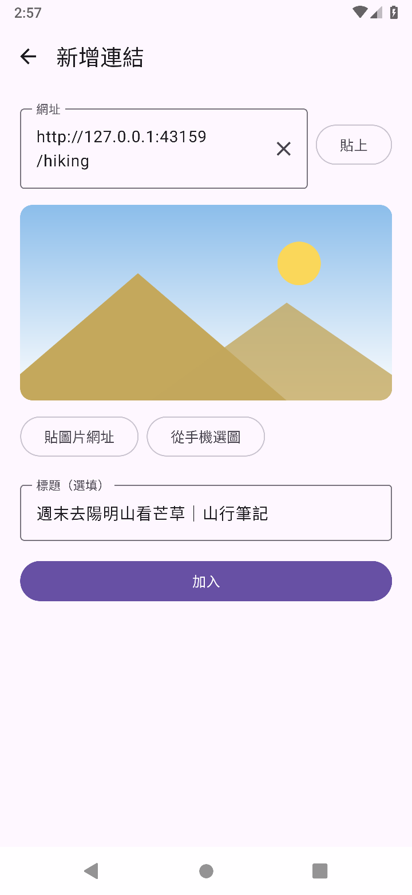
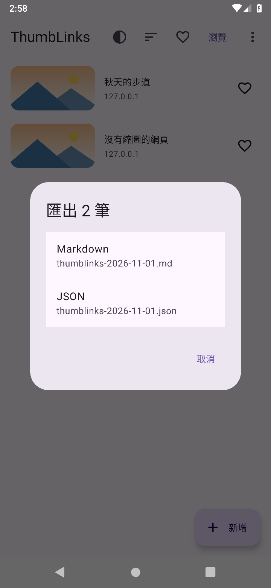
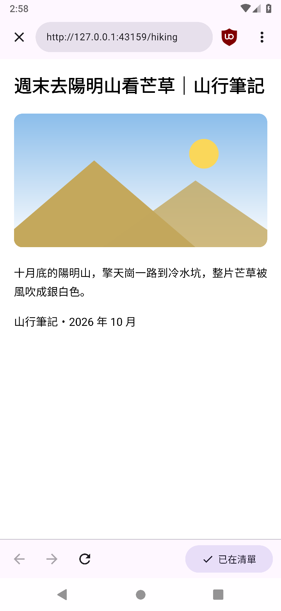
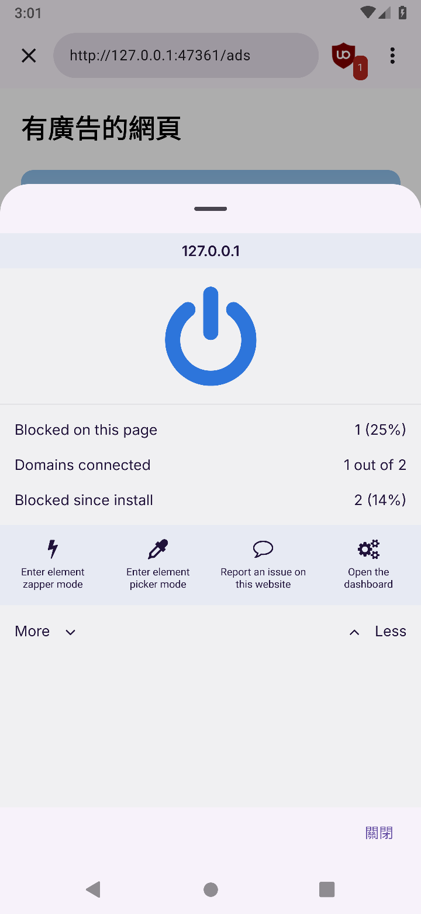
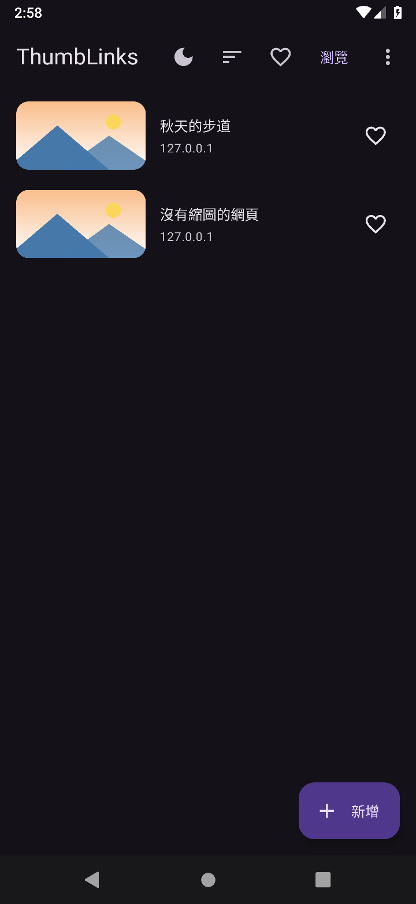

# ThumbLinks

收集網址的 Android App。貼上網址後，App 會去抓那個網頁的縮圖和標題；整份清單可以匯出成 Markdown 或 JSON，
也可以把匯出的檔案匯入回來。

匯出的 Markdown 一筆一行：

```markdown
[](https://example.com/article)
```

| 清單 | 新增 | 匯出 |
| :-: | :-: | :-: |
|  |  |  |

| 內建瀏覽器 | uBlock Origin | 深色模式 |
| :-: | :-: | :-: |
|  |  |  |

截圖是 GitHub Actions 上 Android 9 模擬器跑測試時存的，畫面裡的網頁是測試用的假網站。

## 功能

- **加入**：貼上網址，或從別的 App「分享」文字過來（取第一個 `http://`、`https://` 網址）。
  縮圖依序找網頁的 `og:image`、`twitter:image` 等標籤，標題找 `og:title`、`twitter:title`、`<title>`。
  網頁沒有縮圖或連不上時，可以自己貼圖片網址，或從手機選一張圖；沒有縮圖不能加入
- **清單**：點一筆用內建瀏覽器打開，長按可以編輯或複製網址。排序有新的在上、舊的在上、標題、網域；
  每一筆可以按愛心，右上角可以只看愛心；深色模式可選跟系統、淺色、深色
- **匯出**：一次匯出整份清單，Markdown 或 JSON。有從手機上傳的縮圖時，會打包成 zip（`links.md` 或 `links.json` ＋ `images/`）
- **匯入**：讀回這個 App 匯出的檔案。網址已經在清單裡的跳過；JSON 會帶回加入的時間和愛心，Markdown 只有網址、標題、縮圖
- **內建瀏覽器**：用 GeckoView（Firefox 的引擎），內建 uBlock Origin。uBlock Origin 不在 APK 裡，
  第一次打開瀏覽器時從 Mozilla 附加元件網站下載安裝，之後一天最多檢查一次更新。
  只有一個分頁，不能下載或上傳檔案，沒有歷史紀錄
- 支援 Android 9 以上的 arm64 手機。因為內含 GeckoView，APK 大約 95 MB

## 下載

[最新版 APK](https://github.com/twtrubiks/thumblinks/releases/latest/download/thumblinks.apk)

目前還沒有發布任何版本，這個連結還打不開。沒有上架 Google Play。

## 開發

Kotlin + Jetpack Compose，在 [claude.ai/code](https://claude.ai/code) 雲端 session 開發。
不碰 Android 的規則（取網址、解析網頁、匯出、匯入、資料庫）寫成純 Kotlin，用 JVM 單元測試；
畫面、系統的檔案畫面、內建瀏覽器的測試在 GitHub Actions 的 Android 9 模擬器上跑，主要流程會錄成影片（[`record.yml`](.github/workflows/record.yml)）。

- 規格、架構、約定：[`CLAUDE.md`](CLAUDE.md)
- 雲端環境設定：[`docs/cloud-setup.md`](docs/cloud-setup.md)
- 發版金鑰：[`docs/release-key.md`](docs/release-key.md)
- 之後可能會做：[`docs/ideas.md`](docs/ideas.md)
